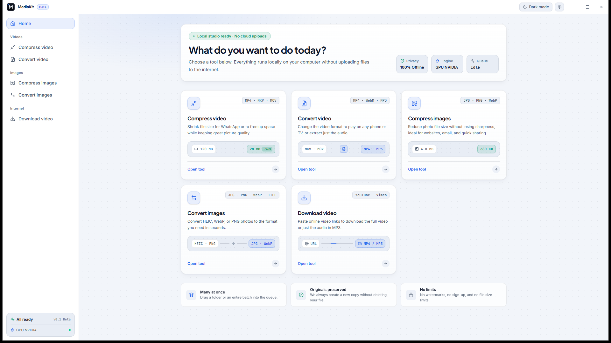
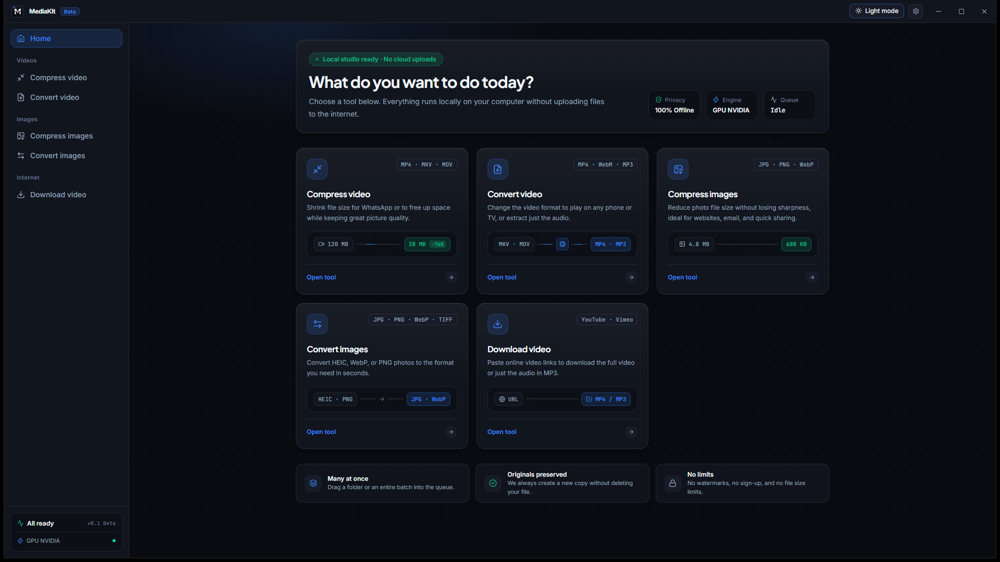
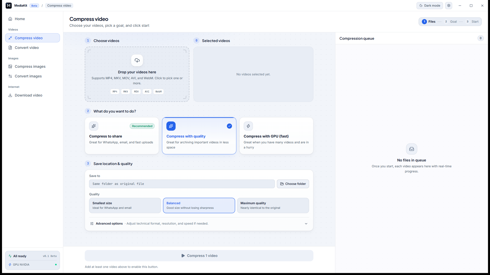
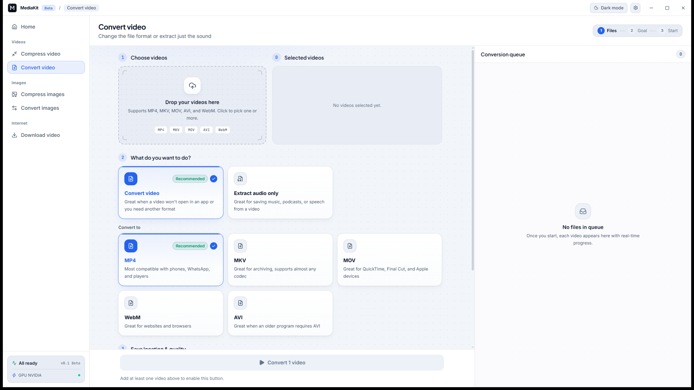
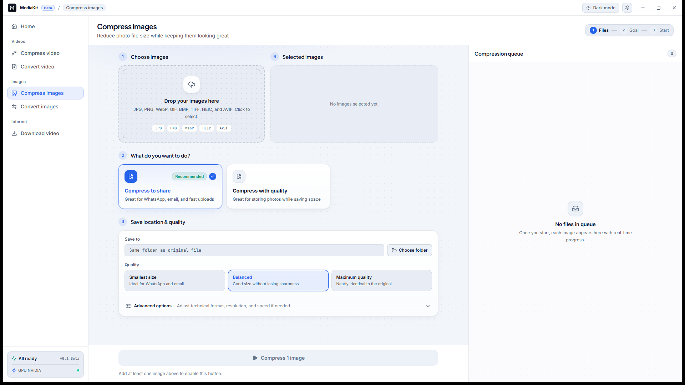
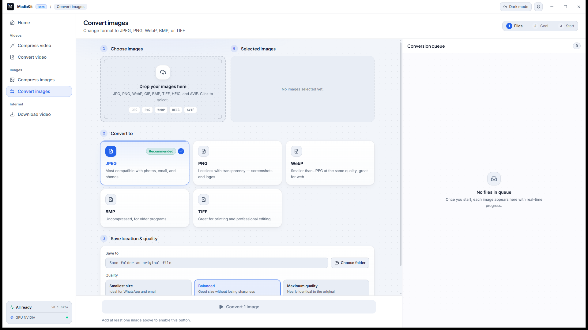
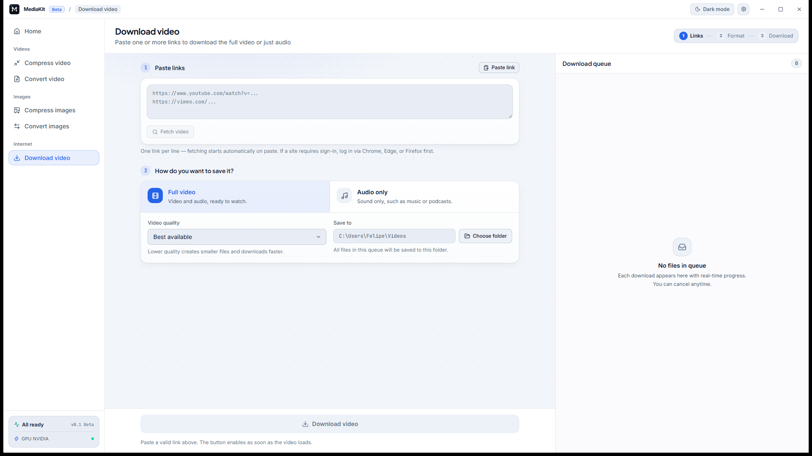

<div align="center">
  
  <h1>MediaKit</h1>
  <p>Local-first Windows desktop app for video, audio, and image compression/conversion and media downloads.</p>

  <p>
    <a href="https://github.com/felipedssantos/mediakit/actions/workflows/ci.yml">
      
    </a>
    <a href="https://github.com/felipedssantos/mediakit/releases/latest">
      
    </a>
    <a href="LICENSE">
      
    </a>
    
  </p>

  <p>
    <a href="#installation">Download</a> ·
    <a href="#features">Features</a> ·
    <a href="#build-from-source">Build from Source</a> ·
    <a href="#contributing">Contributing</a>
  </p>
</div>

## Demo


Watch in full quality: [MP4](https://github.com/felipedssantos/mediakit/releases/download/v0.1.0/mediakit-featured.mp4) · [WebM](https://github.com/felipedssantos/mediakit/releases/download/v0.1.0/mediakit-featured.webm)

## Why MediaKit

- **100% Local Processing**: Everything runs offline on your machine using **Tauri 2**, **React 19**, **TypeScript**, and **Rust**. No files, URLs, or metadata are uploaded to external servers.
- **No Accounts or Limits**: Compress and convert batches of files without size caps, watermarks, or subscriptions.
- **Verified Sidecars**: Bundles `ffmpeg`, `ffprobe`, and `yt-dlp` via pinned versions with SHA-256 checksum verification (or custom user-configured paths in Settings).

## Features

### Video & Audio

| Preset                                         | Codec / Encoder                                     | When to Use                                                                                |
| ---------------------------------------------- | --------------------------------------------------- | ------------------------------------------------------------------------------------------ |
| **Compress for Sharing** (`compress_web`)      | `libx264` (H.264, CRF 28)                           | Small files for WhatsApp, e-mail, and fast uploads                                         |
| **Compress with Quality** (`compress_quality`) | `libx265` (HEVC, CRF 23)                            | High space savings while preserving visual detail                                          |
| **GPU Compression** (`gpu_nvenc`)              | `h264_nvenc` / hardware encoder (CQ 28)             | Fast batch compression when a supported GPU is available                                   |
| **Convert Video** (`convert_mp4`)              | Stream copy or transcode (`H.264`, `VP9`, `MPEG-4`) | Switch containers (`MP4`, `MKV`, `MOV`, `WebM`, `AVI`) without re-encoding when compatible |
| **Extract Audio** (`extract_audio`)            | `AAC`, `MP3`, `PCM`, `Vorbis`, `FLAC`               | Save audio tracks as `M4A`, `MP3`, `WAV`, `OGG`, or `FLAC`                                 |

- Optional resolution scaling (`1080p`, `720p`, `480p`, or custom `WxH`) and quality/CRF tuning.

### Images

| Supported Inputs                                                           | Output Formats                       | Presets                                                                                                       |
| -------------------------------------------------------------------------- | ------------------------------------ | ------------------------------------------------------------------------------------------------------------- |
| `JPG`, `JPEG`, `PNG`, `WebP`, `BMP`, `TIFF`, `GIF`, `HEIC`, `HEIF`, `AVIF` | `JPEG`, `PNG`, `WebP`, `BMP`, `TIFF` | **Compress for Web** (`WebP`, Q75), **Compress with Quality** (`JPEG`, Q90), **Convert to JPEG / PNG / WebP** |

- Optional max-edge resizing (`1080p`, `720p`, `480p`, or custom dimension) preserving aspect ratio.

### Media Downloader

- Download videos or audio-only tracks from YouTube and other `yt-dlp`-compatible sites.
- Quality selector (`best`, `1080p`, `720p`, `480p`) and batch URL input (one link per line).
- Optional local browser cookie reading (`--cookies-from-browser`) for authenticated or age-restricted media.

### Batch Queue & Settings

- Concurrent conversion queue (`1` to `4` parallel jobs) and sequential download queue.
- Live progress percentage, speed readout, cancel, retry, and reveal-in-Explorer actions.
- Configurable default output directories, default presets, and sidecar repair/custom executable paths.

### Desktop Integration

- **System Tray**: Minimize or close to the Windows system tray and restore with a single click.
- **Autostart**: Launches minimized to the tray on Windows startup (`--autostart`).
- **Themes & Locales**: Light and Dark themes, with UI support for `English`, `Português (BR)`, `Português (PT)`, `Español`, and `Français`.

### Experimental

- **Screenshot & Annotation Overlay**: Disabled by default via `SCREENSHOT_ENABLED = false` in `src/lib/features.ts` and `src-tauri/src/features.rs`.

## Screenshots

| Home (Light)                                    | Home (Dark)                                         |
| ----------------------------------------------- | --------------------------------------------------- |
|  |  |

| Compress Video & Audio                           | Convert Video & Audio                                |
| ------------------------------------------------ | ---------------------------------------------------- |
|  |  |

| Compress Images                                          | Convert Images                                         |
| -------------------------------------------------------- | ------------------------------------------------------ |
|  |  |

| Media Downloader                                   |     |
| -------------------------------------------------- | --- |
|  |     |

## Installation

1. Download the latest Windows installer (`MediaKit_<version>_x64-setup.exe`) from the [GitHub Releases](https://github.com/felipedssantos/mediakit/releases/latest) page.
2. _(Optional)_ Verify the SHA-256 checksum against `SHA256SUMS.txt` attached to the release:

```powershell
Get-FileHash .\MediaKit_0.1.0_x64-setup.exe -Algorithm SHA256
```

3. Run the installer and follow the setup wizard.
   - **Windows SmartScreen**: Current installers are unsigned. If Windows displays _"Windows protected your PC"_, click **More info** -> **Run anyway**.
4. **Requirements**: Windows 10 or 11 (x64) and Microsoft Edge WebView2 (pre-installed on Windows 10/11).
5. **Uninstall**: Open Windows **Settings** -> **Apps** -> **Installed apps**, select **MediaKit**, and click **Uninstall**.

## Quick Usage Guide

1. **Choose a tool** from the Home screen or sidebar: Video/Audio, Images, or Media Downloader.
2. **Add files or links**: Drag and drop media files into the window (or paste one URL per line in the downloader).
3. **Select a preset & output options**: Pick compression/format presets, optional resolution/quality adjustments, and an output folder.
4. **Monitor the queue**: Track progress in real time, retry or cancel jobs, and open the finished file directly in File Explorer.

## Build from Source

### Prerequisites

- **OS**: Windows 10 or 11 (x64)
- **[Node.js 20+](https://nodejs.org/)** (`npm` is used by this repository)
- **[Rust (stable)](https://www.rust-lang.org/tools/install)** via `rustup`
- **[Visual Studio Build Tools](https://visualstudio.microsoft.com/visual-cpp-build-tools/)** with the **Desktop development with C++** workload
- **[WebView2 Runtime](https://developer.microsoft.com/en-us/microsoft-edge/webview2/)** (pre-installed on Windows 10/11)

### Setup & Development

1. Clone the repository and install JS dependencies:

```powershell
git clone https://github.com/felipedssantos/mediakit.git
cd mediakit
npm install
```

2. Download sidecar binaries (`ffmpeg`, `ffprobe`, and `yt-dlp`) into `src-tauri/binaries/`:

```powershell
npm run ffmpeg:download
npm run ytdlp:download
```

> Download scripts use pinned versions with SHA-256 checksum verification. Executables are ignored by Git (`src-tauri/.gitignore`) and must not be committed.

3. Run the desktop app in development mode:

```powershell
npm run tauri dev
```

## Production Build

Make sure the sidecar binaries are present in `src-tauri/binaries/` (`ffmpeg:download` and `ytdlp:download`), then run:

```powershell
npm run tauri build
```

The NSIS Windows installer is generated at:

```text
src-tauri/target/release/bundle/nsis/MediaKit_<version>_x64-setup.exe
```

## Available Scripts

| Command                   | Description                                                             |
| ------------------------- | ----------------------------------------------------------------------- |
| `npm run dev`             | Starts Vite frontend dev server                                         |
| `npm run build`           | Compiles TypeScript (`tsc`) and builds production bundle (`vite build`) |
| `npm run preview`         | Previews production bundle locally                                      |
| `npm run lint`            | Runs ESLint across the codebase                                         |
| `npm run format`          | Formats files with Prettier                                             |
| `npm run format:check`    | Checks code formatting with Prettier                                    |
| `npm run typecheck`       | Runs TypeScript type checking (`tsc --noEmit`)                          |
| `npm test`                | Runs frontend unit tests with Vitest                                    |
| `npm run tauri dev`       | Starts full desktop app (frontend + Rust backend)                       |
| `npm run tauri build`     | Builds Windows installer (NSIS)                                         |
| `npm run ffmpeg:download` | Downloads `ffmpeg` and `ffprobe` into `src-tauri/binaries/`             |
| `npm run ytdlp:download`  | Downloads `yt-dlp` into `src-tauri/binaries/`                           |

## Quality Checks

Run the same checks enforced by CI (`.github/workflows/ci.yml`):

```powershell
npm run lint
npm run typecheck
npm test
npm run build
cd src-tauri
cargo fmt --check
cargo clippy --all-targets -- -D warnings
cargo test
```

## Project Structure & Architecture

```text
mediakit/
├── src/                # React 19 + TypeScript + Tailwind CSS v4 frontend
│   ├── components/     # Shared UI, queue cards, settings disclosures
│   ├── hooks/          # Zustand queue stores and Tauri event hooks
│   ├── i18n/           # Translations (en, pt-BR, pt-PT, es, fr)
│   ├── lib/api/        # Tauri IPC boundary (jobs, youtube, files, sidecar, window)
│   └── pages/          # Home, Video/Audio, Images, Downloader, Settings
├── src-tauri/          # Rust backend + Tauri 2 configuration
│   ├── binaries/       # Downloaded sidecar executables (gitignored)
│   └── src/            # Commands, queue core, presets, ffprobe, workers, tray
├── scripts/            # Pinned sidecar downloaders and cargo wrapper
└── docs/               # Architecture documentation
```

- **Frontend (`src/`)**: React 19 + Vite 8 + Tailwind CSS v4 + Zustand 5. UI pages (`HomePage`, `ConverterPage`, `ImageConverterPage`, `YoutubePage`, `SettingsPage`) invoke Tauri commands and listen for queue/progress events.
- **Backend (`src-tauri/src/`)**: Tauri commands (`commands.rs`), queue and job management (`manager/`, `youtube/`), preset builder (`presets/`), media inspection (`probe/`), worker execution (`worker/`, `youtube/download.rs`), and desktop/tray integration (`desktop.rs`).

See [docs/ARCHITECTURE.md](docs/ARCHITECTURE.md) for the end-to-end job flow and security boundaries.

## Troubleshooting

- **Windows SmartScreen blocks the installer**: The installer is unsigned. Click **More info** -> **Run anyway**, and verify the file hash against `SHA256SUMS.txt` from the release page.
- **GPU compression (`gpu_nvenc`) fails or is unavailable**: Hardware encoding requires a compatible GPU (such as an NVIDIA card with up-to-date drivers for `h264_nvenc`). Switch to a CPU preset (`Compress for Sharing` or `Compress with Quality`) if your system has no supported hardware encoder.
- **Media download fails on certain videos**: Some platforms require authentication or frequent `yt-dlp` updates. Enable browser cookies in the downloader options, or update/repair the `yt-dlp` sidecar from **Settings** (or re-run `npm run ytdlp:download` when building from source).
- **`tauri dev` / `tauri build` fails with missing sidecar binaries**: Run `npm run ffmpeg:download` and `npm run ytdlp:download` so `ffmpeg`, `ffprobe`, and `yt-dlp` exist under `src-tauri/binaries/`.

## Changelog

See [CHANGELOG.md](CHANGELOG.md) for release history and notable changes.

## Contributing

Contributions are welcome! Read [CONTRIBUTING.md](CONTRIBUTING.md), follow our [Code of Conduct](CODE_OF_CONDUCT.md), and refer to [SECURITY.md](SECURITY.md) for vulnerability reporting.

## Legal and Privacy Notice

- **Responsible Use**: MediaKit is a local conversion and download tool. Only download content you have explicit permission to access, respecting copyright laws and platform Terms of Service.
- **Browser Cookies**: When required to access media, `yt-dlp` can read cookies from locally installed browsers (`--cookies-from-browser`). This data remains strictly on your machine and is never sent to third parties.

## License

Distributed under the [MIT](LICENSE) license. See [THIRD_PARTY_NOTICES.md](THIRD_PARTY_NOTICES.md) for sidecar binary licenses (`FFmpeg`, `FFprobe`, and `yt-dlp`).
