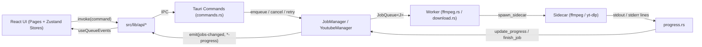

# Architecture Overview

**MediaKit** is a local-first desktop application (Windows & Linux) built with **Tauri 2**, **React 19**, **TypeScript**, and **Rust**. All media inspection, transcoding, image processing, and video downloads run locally via bundled sidecar executables (`ffmpeg`, `ffprobe`, and `yt-dlp`).

## End-to-End Job Flow

## Frontend (`src/`)

- **`src/lib/api/`**: Sole boundary importing `@tauri-apps/*`. Split by domain:
  - `jobs.ts` — media probing, conversion/compression queue commands and events (`jobs-changed`, `job-progress`).
  - `youtube.ts` — URL probing, yt-dlp download queue commands and events (`yt-jobs-changed`).
  - `screenshot.ts` — screenshot capture/overlay commands, events, `snip:` frame URLs, and `asset:` URL conversion.
  - `files.ts` — native file/folder pickers and Explorer reveal.
  - `window.ts` — window controls (`TitleBar`) and webview drag-and-drop listeners.
- **`src/hooks/`**:
  - `createJobQueueStore.ts` + `useQueueEvents` — shared Zustand store factory and Tauri event subscription lifecycle used by `useJobs.ts` and `useYoutubeJobs.ts`.
  - `useMediaInfo.ts`, `useFileDrop.ts`, `useYoutubeForm.ts`, `useSnipSession.ts`.
- **`src/components/`**:
  - Reusable queue primitives (`JobRow`, `JobCardBase`, `JobQueueList`) and thin domain wrappers (`JobCard`, `YoutubeJobCard`, `JobQueue`, `YoutubeJobQueue`).
  - Shared converter shell (`ConverterLayout`, `PendingFilesList`) and settings fields (`OutputDirField`, `ConcurrencySlider`, `QualitySlider`).
- **`src/i18n/pt-BR.ts`**: Typed UI string dictionary (`pt-BR`).

## Backend (`src-tauri/src/`)

- **`error.rs`**: Unified `AppError` (`thiserror`) serializing display messages directly to Tauri IPC callers.
- **`queue/mod.rs`**: Generic `QueueCore<J>` state machine and `JobQueue<J>` runner managing concurrency (`1..=4` for conversions, `1` for downloads), cancellation, retry resets, child handles, and Tauri events.
- **`sidecar.rs` & `progress.rs`**: Shared sidecar spawning, line-stream reading with tail buffering, cancellation polling, and FFmpeg/yt-dlp progress & speed parsers.
- **`presets/`**: Split into `video.rs` (H.264, HEVC, NVENC, stream copy, audio extraction), `image.rs` (JPEG, PNG, WebP, BMP, TIFF), and `builder.rs`.
- **`probe/` & `worker/`**: Media probing (`ffprobe`) and FFmpeg worker execution (`ffmpeg.rs`).
- **`youtube/`**: `probe.rs` (yt-dlp JSON probing), `cookies.rs` (managed `CookieCache` state), `download.rs` (yt-dlp streaming worker with `JobStatus::Finalizing` during mux/audio post-processing), and `manager.rs`.
- **`desktop.rs`**: System tray icon, single-instance focus restoration, close-to-tray lifecycle, and Windows autostart handling.

## Feature Flags

- **`SCREENSHOT_ENABLED`** (`src/lib/features.ts` and `src-tauri/src/features.rs`):
  Set to `true` by default. Enables the `Print Screen` and `Alt+Shift+S` global shortcuts, tray menu entry, Screenshot page, and `snip-overlay` window backed by `src-tauri/src/screenshot/` (`capture`, `clipboard`, `commands`, `region`, `windows`) and the `snip://` custom URI scheme protocol.

## Security Boundaries

- **CSP (`src-tauri/tauri.conf.json`)**: Restricts scripts to `'self'`, fonts to `'self' data:`, IPC to `ipc: http://ipc.localhost`, and images to `'self' asset: http://asset.localhost https: data: blob:` (needed for yt-dlp remote thumbnails and local screenshot assets).
- **Asset Protocol**: Scoped strictly to `$TEMP/mediakit-screenshots/**` and `$APPLOCALDATA/screenshots/**`.
- **Capabilities (`src-tauri/capabilities/default.json`)**: Grants only window controls, `dialog:allow-open`, and `opener:allow-reveal-item-in-dir`. Sidecars are invoked exclusively from Rust without exposing `shell` IPC permissions to the webview.
